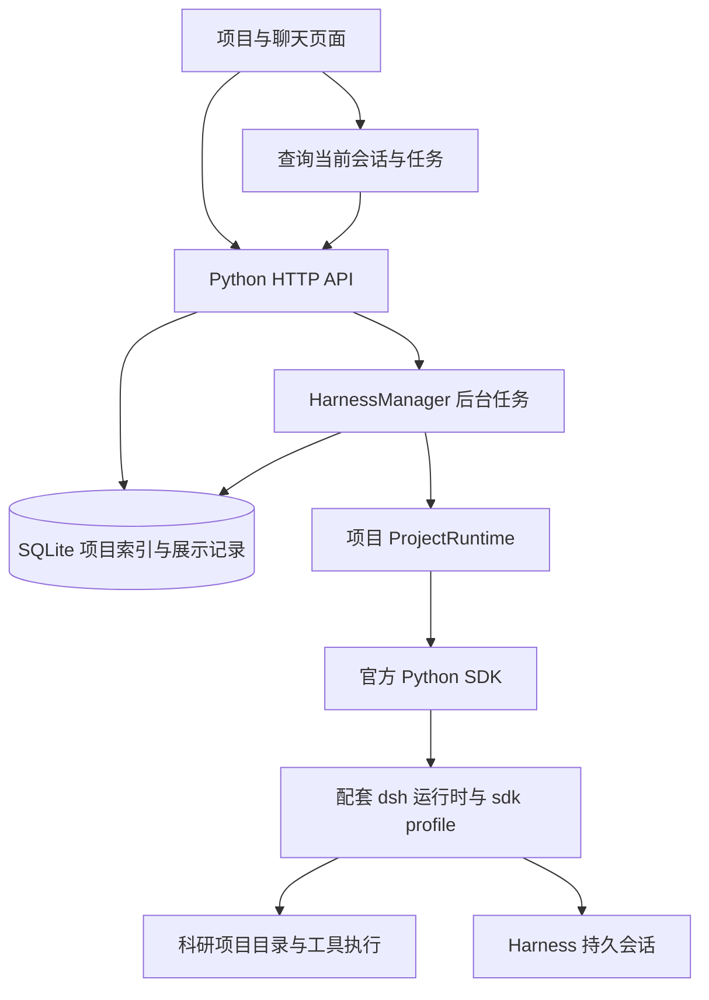

# Research Harness 项目文档

更新日期为 2026-11-18。本文以核心框架提交 `bfc4352` 的代码和验收结果为基线，描述当前架构、功能、接口及完整版开发流程。环境搭建见[安装与运行指南](installation.md)。

## 1. 项目目标

### 科研流程整合

项目页已增加研究总览、文献库及四个科研阶段。各阶段按项目绑定持久 SDK Session，通过 `research.py` 组织当前输入。问题调研使用 SDK 原生网页工具，确认问题时保存模型回复中的文献清单。痛点定位读取逐篇题目、摘要和 AI 分析。方案接收背景与已确认痛点，实验接收已确认方案并在项目目录用原生工具运行和分析。

SQLite 中的 `research_sessions` 绑定项目、阶段和 Session。每次发送将当前背景及上游确认版本写入 `research_runs`。确认时将编辑后的交接内容存入 `research_confirmations`，拒绝确认基于过期输入的回复。旧版本和阶段对话留在历史中。

科研状态通过 `GET /api/projects/{id}/research` 读取，`POST` 保存背景。子路由 `/{stage}/session`、`/{stage}/chat` 和 `/{stage}/confirm` 分别用于打开阶段 Session、发送和确认结果。实验通过 `GET/POST /api/runs/{id}/approval` 获取及回答当前实验 Session 的工具审批。界面显示工具结果摘录，完整 Harness 历史保存在本地运行数据。

以下基线部分记录核心框架提交 `bfc4352` 的实现与历史路线。

Research Harness 面向本地 AI 辅助科研，围绕科研项目目录组织对话、文件、代码与实验活动。当前核心版已打通创建项目、新建 Session、多轮交流、保存历史和重启继续的流程。

Agent 执行由官方 DeepSeek Harness Python SDK 的完整 `sdk` profile 承担。应用负责用户界面、项目索引、后台任务和展示记录。后续逐步扩展为文献调研、假设形成、实验设计、执行、分析与研究报告的连续工作台。

## 2. 当前功能与验收

| 功能 | 当前实现 |
| --- | --- |
| 项目管理 | 登记名称和已存在的绝对目录，规范化路径，重复目录返回已有项目 |
| 会话管理 | 每个项目可新建多个 Session，选择会话并加载历史 |
| 会话标题 | 初次提交时从消息生成最多 36 个字符的标题 |
| 多轮交流 | 同一运行时复用 Session 句柄，继续使用既有上下文 |
| 重启恢复 | 已开始的会话通过 `resume_session()` 恢复 |
| 后台执行 | HTTP 接受任务后返回 `202`，后台线程执行 SDK 调用 |
| 任务状态 | 保存等待、运行、完成、错误及异常中断状态 |
| 请求幂等 | 相同 ID和相同内容返回已有任务，冲突内容返回 `409` |
| 并发控制 | 全应用同时执行一个用户提交任务，项目和历史浏览保持可用 |
| 页面刷新 | 最近选择和草稿保存在浏览器，任务与历史从后端重新加载 |
| 错误反馈 | 展示 SDK 错误与交互说明，对常见密钥形式进行脱敏 |
| Python 与文件工具 | 通过 SDK profile 使用 Shell 和文件工具，依赖项目环境与权限 |
| 网页工具 | 使用 profile 中已配置且就绪的搜索与获取能力 |
| 权限审批 | 专用请求线程接收审批并返回拒绝，在任务中记录原因 |
| AI 提问 | 回调返回取消，并记录问题说明 |

本机已在 Windows x64、Python 3.14、SDK `0.2.2rc2` 上完成以下真实验收。

- 同一会话记住实验代号并在后续消息中召回。
- 关闭并重新启动服务后，恢复原会话并再次召回代号。
- 分别检查两个会话的持久历史，确认隔离。
- 通过 Python 标准库读取 CSV，实际生成结果文件，核验结果为 `6`。
- 实际调用 `web_search` 并取得官方文档来源链接。
- 在页面验证新建会话、刷新历史、项目目录校验和恢复展示。
- 17 项无密钥回归测试通过，依赖检查和 JavaScript 语法检查通过。

本机还验证了两个 Windows 环境条件。运行时进程从 `C:\` 启动可处理所遇到的原生模块加载问题，测试目录具备当前用户完整权限后，可在 `workspace-write` 下执行 Python。具体操作见安装指南。

## 3. 代码框架

```text
research-harness/
├─ README.md
├─ requirements.txt
├─ .env.example
├─ .gitignore
├─ docs/
│  ├─ installation.md
│  └─ project.md
├─ my-harness-ui/
│  ├─ server.py
│  ├─ harness.py
│  ├─ storage.py
│  ├─ index.html
│  ├─ app.js
│  ├─ styles.css
│  └─ tests/
│     └─ test_core.py
└─ .research-harness/       本机运行数据
```

### 3.1 HTTP 与启动层

`server.py` 使用 `ThreadingHTTPServer` 和 `BaseHTTPRequestHandler` 提供页面与 JSON API。`main()` 解析模型、端口、凭据文件和数据目录，加载环境，取得 `DataLock`，初始化存储与任务管理器，然后启动 HTTP 服务。

`DataLock` 防止多个应用实例同时恢复同一份应用数据。Windows 使用 `msvcrt` 文件锁，POSIX 使用 `fcntl.flock`。服务关闭时清理 SDK 运行时和工作线程，再释放数据目录锁。

### 3.2 SDK 与任务层

`harness.py` 包含以下职责。

| 对象或函数 | 责任 |
| --- | --- |
| `ProjectHarness` | 在官方 SDK 公共生命周期方法上串行化启动与关闭，阻止关闭后的迟到调用重新启动运行时 |
| `ProjectRuntime` | 管理一个项目的 SDK 实例、Session 句柄缓存、审批处理线程和问答回调 |
| `HarnessManager` | 校验提交、维护全局活动任务、启动后台线程、完成记录和错误收尾 |
| `safe_error()` | 清理常见环境密钥与密钥文本，限制展示错误长度 |

各项目按需创建一个长驻实例，运行时通过配置传入 `profile="sdk"`、`provider="deepseek-official"`、模型、固定 Harness home 与项目 `cwd`。关闭等待预算设置为 30 秒。

### 3.3 存储层

`storage.py` 封装 SQLite 操作，通过独立连接执行请求，启用外键和 WAL。创建任务时将用户消息与任务记录一起提交，完成任务时将结果状态与最终回复一起提交。

读取会话使用显式读事务，使消息和任务状态来自同一个数据库快照。这个约定保证页面看到任务完成时，对应的已提交回复也可加载。

### 3.4 前端

`index.html` 提供项目侧栏、会话列表、聊天区域和项目登记对话框。`app.js` 管理选择状态、API 调用、任务提交和轮询。`styles.css` 提供桌面与窄屏布局。

消息与错误通过 `textContent` 渲染。浏览器 `localStorage` 保存最近项目、最近会话、会话草稿和待确认的提交 ID。项目与会话切换使用选择版本，过期的历史查询结果会在切换时被丢弃。

## 4. 数据与执行流程

### 4.1 整体结构



### 4.2 当前数据模型

| 表 | 主要字段 | 作用 |
| --- | --- | --- |
| `projects` | `id`、`name`、`directory`、`created_at` | 本机项目登记，目录唯一 |
| `sessions` | `id`、`project_id`、`title`、`started`、创建及更新时间 | 项目归属和 SDK 恢复标识 |
| `runs` | `id`、`session_id`、`message`、`status`、`reply`、`error`、`finish_reason`、`notices`、时间 | 任务幂等、状态和结果 |
| `messages` | `id`、`session_id`、`run_id`、`role`、`content`、`created_at` | 页面用户消息与最终回复 |

应用 Session ID同时用于 SDK Session，形式为 `session-<uuid>`。任务 ID由调用方生成，浏览器使用 `crypto.randomUUID()`。`messages` 对同一任务和角色设唯一约束。

默认数据目录如下。

```text
.research-harness/
├─ app.lock
├─ app.sqlite3
├─ app.sqlite3-wal         数据库运行期间可能存在
├─ app.sqlite3-shm         数据库运行期间可能存在
└─ dsh-home/
   ├─ profiles/
   ├─ sessions/
   ├─ storages/
   └─ 凭据与运行时管理文件
```

SQLite 保存应用项目索引和展示记录。模型恢复的历史由 Harness 自身持久化保存，包含其会话与工具活动。浏览器缓存用于界面恢复，应用数据库和 Harness home 共同组成恢复所需的数据。

### 4.3 一次任务的流程

1. 页面提交 `session_id`、`request_id` 和消息。
2. 管理器检查重复请求、关闭状态、活动任务和项目目录。
3. 存储层提交 `queued` 任务及用户消息，HTTP 返回 `202`。
4. 后台线程把任务标记为 `running`，取得项目运行时。
5. 会话首次执行使用 `start_session(id)`，重启后的已开始会话使用 `resume_session(id)`。
6. 调用 `Session.run()`，审批线程与问答回调处理收到的交互。
7. 将 `RunResult.final_response`、`finish_reason` 和任务状态一起保存。
8. 页面每秒读取当前会话，收到终态后停止本轮轮询。

普通会话在进程内复用句柄。恢复会话需要原 ID、原 Harness home 和有效的项目目录。SDK 恢复流程由官方接口负责。[Python SDK](https://github.com/deepseek-ai/deepseek-harness/blob/master/python/sdk/README.zh.md)

### 4.4 状态与恢复语义

| 状态 | 含义 |
| --- | --- |
| `queued` | 提交已入库，等待工作线程开始 |
| `running` | 正在初始化或驱动 SDK 活动 |
| `completed` | SDK 返回 `finish_reason="completed"` |
| `error` | SDK 异常或其他结束原因，错误及可能的回复保留 |
| `interrupted` | 服务启动时发现上次存在未结束任务，实际结果待核对 |

正常完成后仍应验证科研产物是否满足要求，尤其是命令结果、数据数值和来源证据。异常恢复后，界面保留已有记录，用户检查实际状态后明确发起下一条消息。

当前服务启动时会将遗留的 `queued`、`running` 记录标记为 `interrupted`。后续版本需要继续完善崩溃后子进程识别与任务结果对账。

## 5. HTTP 接口与配置

### 5.1 接口清单

| 方法与路径 | 请求内容 | 响应内容 |
| --- | --- | --- |
| `GET /api/projects` | 空 | `projects` 列表 |
| `POST /api/projects` | `name`、`directory` | `project`，状态码 `201` |
| `GET /api/projects/{id}/sessions` | 空 | `sessions` 列表 |
| `POST /api/projects/{id}/sessions` | `{}` | `session`，状态码 `201` |
| `GET /api/sessions/{id}` | 空 | `session`、`messages`、`runs` |
| `POST /api/chat` | `session_id`、`request_id`、`message` | `run`，状态码 `202` |
| `GET /api/runs/{id}` | 空 | `run` |

例如，消息提交使用以下 JSON 对象。

```json
{
  "session_id": "session-example",
  "request_id": "unique-request-id",
  "message": "读取项目数据并说明下一步实验计划"
}
```

其中 `session_id` 应来自新建会话接口。任务详情中可读取 `status`、`reply`、`error`、`finish_reason` 和 `notices`。常见错误包括输入格式错误 `400`、跨来源 POST `403`、对象缺失 `404`、任务忙碌或请求冲突 `409`、关闭中的服务 `503`，其他异常返回 `500`。

当前消息最多 16000 个字符，HTTP POST 正文最多 131072 字节。项目名称最多 100 个字符。项目目录需要存在，并使用规范化绝对路径保存。

### 5.2 依赖与运行配置

| 项目 | 当前设置 |
| --- | --- |
| Python SDK | `deepseek-harness-sdk==0.2.2rc2` |
| 配套运行时 | SDK 自动依赖的同版本 runtime wheel |
| 环境文件 | `python-dotenv==1.2.1`，启动环境优先 |
| 模型路由 | `deepseek-official` |
| 默认模型 | `deepseek-v4-flash`，可用 `--model` 覆盖 |
| 权限预设 | `workspace-write` |
| 数据目录 | 可通过 `--data-dir` 指定 |
| 网络入口 | `127.0.0.1`，默认 `8001` |

当前应用使用标准库 HTTP 服务和 SQLite，依赖完整 SDK profile 提供的工具。原生工具的实际可用性还取决于 Python 环境、权限、网络、凭据和可选资源。

## 6. 当前能力状态

| 能力 | 当前工作台状态 | 后续建设方向 |
| --- | --- | --- |
| 项目与持久会话 | 已交付 | 标题编辑、归档、检索、迁移 |
| Shell、Python、文件操作 | 由 SDK 提供，已实测基础链路 | 环境选择、实验配置与结果跟踪 |
| 网页搜索 | 由就绪的提供方提供，已实测 | 论文元数据、来源管理、文献库 |
| 工具执行详情 | 页面展示任务状态与最终结果 | 事件日志、工具卡片和增量展示 |
| 审批与 AI 提问 | 当前拒绝或取消并记录说明 | 网页回答和单次授权 |
| 计划与目标 | SDK 可路由相关命令，计划审阅受到当前交互策略约束 | 完整审阅、目标控制和阶段追踪 |
| 项目长期知识 | 当前已交付 Session 历史 | 研究概览、带来源结论、假设和检索 |
| 附件与产物 | Agent 可以操作项目文件 | 上传、下载、预览和产物登记 |
| Office、浏览器、MCP | 通过相应插件与资源扩展 | 按科研任务逐项配置和验收 |
| 多电脑工作 | 同步代码，各机独立保存数据 | 显式导入导出和路径映射 |
| 服务部署 | 本机单用户工作台 | 认证、授权、用户隔离与运行运维 |

SDK 协议当前没有通用的单会话取消方法，应用级停止设计需要考虑关闭运行时的影响范围。提问请求 ID属于当前运行时生命周期，重启后需使旧请求失效。[SDK 协议文档](https://github.com/deepseek-ai/deepseek-harness/blob/master/packages/sdk/protocol/README.zh.md)

## 7. 日常开发流程

1. 阅读与改动有关的应用模块、测试和对应的官方开发文档，记录 SDK 版本与行为依据。
2. 对新增行为先明确用户入口、数据库变更、SDK 调用与验收样例。
3. 涉及持久化字段时，加入显式数据库版本与迁移测试，再修改数据结构。
4. 实现最小可用流程，复用当前 `Storage` 和 `HarnessManager` 的事务与任务入口。
5. 运行相关无密钥测试，再使用单独的验收项目和数据目录做真实调用。
6. 更新这两份文档中的行为、参数和能力状态，检查 Git 暂存范围和敏感数据。

在仓库根目录执行当前检查。

```powershell
.venv\Scripts\python.exe -m unittest discover -s my-harness-ui/tests -v
.venv\Scripts\python.exe -m pip check
node --check my-harness-ui/app.js
git diff --check
```

测试使用 SDK 公共接口替身验证任务语义，并包含生命周期包装、SQLite 并发快照和 HTTP 回归。真实验收应同时检查文件内容、持久会话和实际工具结果。

## 8. 完整版开发路线

以下阶段是后续实现建议，按依赖关系推进。每阶段先完成可验收的纵向流程，再扩展界面细节。

### 阶段一　执行事件与用户交互

**目标**是用户可以看见工具执行过程，并回答权限审批、AI 问题和计划审阅。

- 在 `harness.py` 接入 `on_notification`，保存原始事件来源与递增展示游标。
- 将任务和交互协调逐步抽出到 `service.py`，SDK 适配继续集中在 `harness.py`。
- 为事件和待回答交互增加数据库表与迁移，按项目、会话和任务关联。
- 增加事件增量查询与交互回答 API，先沿用轮询，再按实际负载引入 SSE。
- 将审批回调接到网页决定，支持单次批准、拒绝和取消。问答回调返回每个原问题的答案。
- 处理浏览器断开、SDK 取消、重复答案和运行时重启，使失效请求退出等待。

**验收**包括真实 Shell 任务的工具记录、一次批准和一次拒绝、问题回答与取消、计划审阅，以及刷新页面后恢复仍有效的交互。事件粒度以 SDK 当前公开的通知为准。

### 阶段二　文件、附件与研究产物

**目标**是论文、数据和生成结果能够在项目内被登记、查看和下载。

- 增加项目文件浏览、受控上传、产物登记和下载接口，规范化校验路径及符号链接目标。
- 登记文件类型、来源任务、生成时间和校验和，关联工具结果与最终报告。
- 增加图片预览和文本查看，按实际需求接入 PDF、表格和 Office 资源。
- 将 PDF 和数据文件交给项目文件流程，图片输入按 SDK 支持的内容块协议处理。

**验收**包括上传论文或 CSV、Agent 实际读取、运行分析、展示图表、下载结果，以及路径越界和失效文件的错误处理。

### 阶段三　科研知识与文献管理

**目标**是新会话能够接续项目研究问题、证据、假设和决策。

- 建立研究概览、文献条目、阅读笔记、假设、结论和决策的存储结构。
- 为结论保存论文页码或 URL、实验任务、结果文件、确认状态和时间，保留修订记录。
- 提供用户确认的知识保存流程，将会话中的候选结论形成可编辑草稿。
- 新会话加载项目概览，按问题检索相关材料，明确记录实际注入的上下文。
- 先使用文件与结构化查询，资料量增长后再评估全文检索、向量检索或记忆 MCP。

**验收**包括在会话 A 保存带来源结论，在独立会话 B 检索并引用，以及修正旧结论后追踪其版本与影响。

### 阶段四　可复现实验与远程计算

**目标**是将执行代码扩展为可追踪、可复现的实验任务。

- 保存解释器或环境、代码提交、数据版本、参数、随机种子、启动命令、退出码、指标和产物。
- 将长实验从 HTTP 请求生命周期中分离，建立任务队列、运行日志和重启后的状态对账。
- 增加任务取消与重试，先明确运行时关闭对子任务和同项目 Session 的影响。
- 使用配置好的 SSH 别名接入实验机器，当前用户环境提供 `4090` 和 `4090-48` 两个目标。
- 为远程任务记录主机、远端目录、作业标识及日志位置，处理断连、重新连接和结果回传。
- 按实际需要接入 GPU 状态、环境准备及受控并发。

**验收**包括本地和远端各完成一次实验，核验同配置的结果、失败日志、断连后的状态恢复及任务取消。主机密钥与登录凭据由本机配置管理。

### 阶段五　科研流程编排

**目标**是串联研究问题、文献、实验、结果与报告。

- 将流程表示为带依赖的步骤，每步关联 Session、输入、产物和验收标准。
- 明确文献结论、实验设计、资源消耗和报告发布等需要用户确认的节点。
- 复用已验证的工具及子 Agent 能力，为调研、实验与结果审查分配任务并汇总来源。
- 在产物与任务结构稳定后生成研究报告，链接每项结论对应的证据。
- 为暂停、恢复、失败和返工保存流程状态，重启后重新核对外部作业状态。

**验收**以一个真实科研问题完成从调研到报告的全过程，并能从报告追溯到论文、实验参数、代码和结果文件。

### 阶段六　部署、迁移与持续运行

**目标**是支持更长时间运行、跨电脑迁移和有明确访问边界的部署。

- 增加应用数据库版本、升级与备份恢复工具，对 SDK 历史兼容性进行升级前检查。
- 提供显式的数据导入导出、项目路径映射及恢复校验，处理原位置和目标位置差异。
- 根据并发需求选择每会话或每项目运行时策略，增加资源上限、空闲回收和运行时健康状态。
- 网络部署时增加认证、项目访问控制、用户隔离、日志审计和密钥管理。
- 引入平台测试矩阵和持续集成，区分无密钥检查与具备授权凭据的真实工具验收。

**验收**包括备份恢复、支持版本间升级、跨电脑迁移、用户访问校验和长期运行中的失败恢复。

## 9. 下一步建议

最近一轮开发优先完成阶段一，使审批、问题和计划审阅可以在页面上闭环。随后推进文件产物与项目知识，再接入长实验和远程算力。每个阶段同时维护代码、数据迁移、验收样例和本项目文档。

官方开发文档建议从 SDK、profile、Session 和工具提供方逐项阅读，按具体功能核验当前版本接口。[SDK profile 文档](https://github.com/deepseek-ai/deepseek-harness/blob/master/packages/bundle/sdk-app/README.zh.md)、[Workspace 文档](https://github.com/deepseek-ai/deepseek-harness/blob/master/packages/workspace/workspace/README.zh.md)、[记忆 MCP 文档](https://github.com/deepseek-ai/deepseek-harness/blob/master/docs/user/guide/mcp-memory.zh.md)
